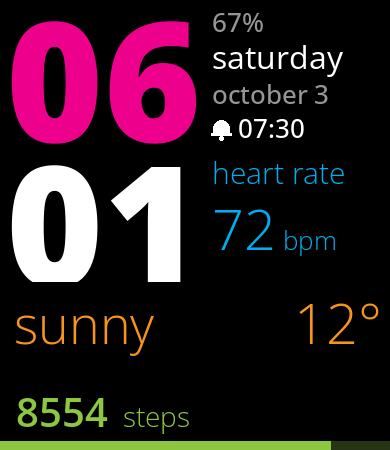

# Amazfit Active 2 Square watch faces

Zepp OS watch faces for the Amazfit Active 2 (NFC) Square (390×450).

| Face | Description |
|---|---|
| [zuny](zuny/) | Zune-inspired typographic face: heavy stacked time with a tappable accent colour, an editable complication slot (18 options), weather, alarm, and a steps bar along the bottom edge. Has an always-on screen. |
| [volt](volt/) | Bold yellow sporty test face. |



## Build & install

Requires Node and Zeus CLI (`npm i -g @zeppos/zeus-cli`), Python 3 + Pillow.

```sh
cd zuny
python3 gen_edit.py          # regenerates all assets + watchface/mid.js
zeus login                   # once
zeus preview                 # pick "Amazfit Active 2 NFC (Square)", scan QR in Zepp app (Developer Mode)
```

The asset scripts use Open Sans (OFL) from `diskos-disco/ui/fonts/zune/OpenSans-VF.ttf`; adjust `VF` in `zuny/gen_assets.py` if building elsewhere.

`tools/pick.py` drives `zeus preview` non-interactively; `tools/qr2png.py` turns the terminal QR into a PNG.
